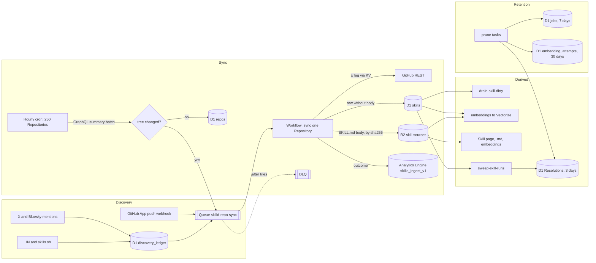

# ADR-0019: Skill ingestion on Cloudflare primitives

**Status:** Accepted
**Date:** 2026-11-12

Amends [ADR-0005](0005-v3-cli-harness-artifact-delivery.md) and [ADR-0015](0015-follow-moved-repositories.md).

## Context

`skilld-db` reached D1's 10 GB limit on 2026-11-04. Writes failed for eight days.
Twenty-two scheduled tasks went stale and ingestion stopped. #688 fixed the
cause: `sweep-skill-runs` wrote a Resolution with about 60 KB of attestations
every 50 minutes per Skill, twice, and never deleted one.

The same shape repeats across ingestion. D1 is a transactional store. The
pipeline uses it as a blob store, an append-only log, and a job queue. Each use
grows without a retention window.

### Measured on 2026-11-12

Bounded reads of the production database, with the Worker's own code.

| Store | Rows | Bytes (sampled) | Growth | Retention |
| --- | --- | --- | --- | --- |
| `artifact_resolutions` | 114,585 | 34 KB each: `attestation_json` 23 KB, `attestation_statement_json` 10 KB, `check_results_json` 1 KB | one per run check | 3 days since #688 |
| `artifact_attestations` | 114,096 | 23 KB each, a second copy of the attestation | one per ready Resolution | cascades from #688 |
| `artifact_check_results` | 792,206 | about 7 rows per Resolution | with Resolutions | cascades from #688 |
| `skills` | 25,145 | 22 KB each: `rendered_raw` 8.9 KB, `rendered_html` 11.9 KB, `rendered_frontmatter` 0.5 KB, `assets` 0.7 KB. Largest `rendered_raw` 117 KB | one per Skill, rewritten on every content change | none, soft-retired |
| `jobs` | 146,816 | 230 bytes each of payload and retry text | up to 250 an hour from `sync-github-skills` | none |
| `skill_revisions` | 146,515 | 830 bytes each, the commit message | up to 30 per changed SKILL.md | none |
| `scheduled_runs` | 159,973 | small | 6 writes per task run, about 1,850 runs a day | 45 days |
| `activity` | 241,974 | small | one per publish or update | none, user-facing feed |
| `embedding_attempts` | 25,578 | small | one per embedding | none |
| `discovery_ledger` | 80,080 | `evidence_text` | one per mention | none |
| `ai_ready_pages` | about 11,700 | 0.5 KB markdown | sequence at 23,359,165 | module owned |

The estimate: `artifact_resolutions`, `artifact_attestations`, and their check
results hold about 7 GB of the 10 GB. `skills` holds about 550 MB, of which
`rendered_html` is 300 MB and derivable from `rendered_raw`.

Reads: 224,109 D1 queries read 147 million rows in the 24 hours before this
ADR, with writes failing the whole time. That is page traffic and the
five-minute tasks, not ingestion.

[GitHub](https://github.com): the hourly sync reads 250 Repositories. One [GraphQL](https://graphql.org) batch of 100
summaries answers most of them as unchanged. A changed Repository under 50
Skills costs about 4 requests: summary, tree, a blob batch, and a commit
batch. REST reads already send `If-None-Match` from a KV ETag cache
(`gh-etag:<url>`{lang="html"}, 7 days), and a 304 spends no quota. The artifact build path
sends no conditional request: a first check of a Skill costs about 8 REST
requests plus a codeload archive. Since #688 a ready Skill is rechecked weekly,
so the sweep spends about 1,000 requests a day instead of 30,000.

`ai_ready_pages`: the AUTOINCREMENT sequence reached 23.3 million for 11,700
rows because `seedRoutes` in nuxt-ai-ready attempts one INSERT per sitemap URL
on every seed, and [SQLite](https://sqlite.org) bumps the sequence on every attempted insert, even
one that conflicts and changes nothing. The `retired` sitemap added 10,462
URLs that answered 410, so each seed inserted them and the indexer deleted them
again, with an FTS delete and insert each time. #690 removed that sitemap.
The remaining churn is a module defect, fixed in nuxt-ai-ready, not here.

Invocations: 25 scheduled tasks fire about 1,850 times a day. Five of them run
every five minutes and most of those runs find no work, yet each pays six
`scheduled_runs` and `sync_jobs` writes. Queue consumers take one message per
invocation, so a 250-job sync is 250 invocations plus continuations.

## Decision

Each kind of data lives in the [Cloudflare](https://cloudflare.com) primitive built for it. D1 keeps
small relational state, and every table that grows names its retention.

### D1 holds relational state with a named retention

Every table a task appends to carries a retention constant and a prune task.
A table without one is a defect. The windows:

| Table | Window | Prune |
| --- | --- | --- |
| `artifact_resolutions` and cascades | 3 days, public, settled, not the newest attestation of its Artifact | `sweep-skill-runs` (#688) |
| `jobs` | 7 days after `completed_at` | `prune-finished-jobs` |
| `failed_jobs` | 30 days | `prune-finished-jobs` |
| `job_batches` | once finished and empty | `prune-finished-jobs` |
| `embedding_attempts` | 30 days | `prune-finished-jobs` |
| `scheduled_runs` | 45 days | every observed run |
| `repo_star_observations` | 90 days | every sync |
| `x_post_metrics` | 30 days | `refresh-x-engagement` |
| `skill_revisions` | newest 30 per Skill | sync write, this ADR |
| `activity` | none: a user-facing feed. Reads page by `created_at` | not pruned |
| `discovery_ledger`, `discovery_candidates` | none: one row per Repository ever seen, under 100 KB each thousand | not pruned |

A prune deletes in batches of at most 500 rows through an index seek, with a
cap on batches per run. It runs before the task's own start row is written, so
it can free space while the database is full.

### Blobs live in R2, addressed by content

The SKILL.md body moves to R2. `skills.rendered_raw_sha256` already names its
bytes. The key is `v1/skill-source/sha256/<first two hex>/<sha256>.md` in the
`PUBLIC_ARTIFACTS` bucket, the same shape as an Artifact. Two Skills with the
same body share one object. A put is idempotent, so a retried sync writes the
same bytes to the same key.

`rendered_html` is not stored. `parseSkillMd` is a pure function of the body.
The Skill page already re-parses the body on every request (it did before this
ADR, for description repair), so the column was dead weight. The rendered page
stays cached by the edge cache as it is today.

D1 keeps what queries filter and sort on: identity, description, frontmatter
JSON, `rendered_raw_sha256`, `rendered_raw_bytes`, status, counters, scores.

One server utility, `readSkillSource`, reads the body: R2 by sha256 first, then
the D1 column while it still holds bytes. Every reader goes through it:
the Skill page, the `.md` route, the `/api/skills` body select, embeddings,
rename detection, validation, and the AI-ready markdown source.

Attestations stay in D1. With the 3-day window a Resolution row is transient,
and the newest attestation of an Artifact is one row per Artifact. The
duplicate in `artifact_attestations` serves the Artifact routes and build
reuse. Moving it to R2 saves nothing once retention holds.

### GitHub reads are conditional and immutable reads are cached

`ghRequest` keeps its KV ETag cache for REST. The artifact build path adopts
it for the two mutable reads it makes, `GET /repos/{o}/{r}` and `git/ref/...`.
A 304 costs no quota and keeps the exact-commit pin that ADR-0005 requires.
Immutable objects (trees, commits, blobs by SHA) stay in the existing
`artifact-github:v1:` KV cache for 30 days.

The GraphQL summary batch is the one unconditional read. It costs 3 requests
an hour for 250 Repositories and answers most of them as unchanged. It stays.

### A GitHub App push webhook marks a Repository for sync

`layers/artifact-delivery/server/api/v1/webhooks/github.post.ts` handles only
`installation` events today. It gains `push`: on a push to the default branch
of an installed Repository, it enqueues a `registry/repo-maintenance` sync job
with `unique: true` on `owner/repo`. The job is the same one the hourly cron
creates, so a webhook never produces a second code path. A Repository without
the App keeps the hourly poll. Delivery IDs stay deduplicated in
`github_app_webhook_deliveries`.

### One Repository sync is a Workflow

Today a Repository with more than 250 SKILL.md files chains across queue
deliveries through `repo_sync_progress` and a `release(1)`{lang="ts"}, and each delivery
counts as an attempt. The sync becomes a Workflow, `SKILL_SYNC_WORKFLOW`, with
one instance per Repository, ID `sync:<owner>/<repo>`{lang="html"}:

1. `summary`: GraphQL summary, move detection (ADR-0015), unchanged short-cut.
2. `tree`: REST tree with ETag, truncation check.
3. `slice-N`: one step per 50 SKILL.md paths. Blob batch, commit batch, parse,
   R2 puts, D1 writes under the 8 MB batch budget. Each step retries alone.
4. `finish`: `repos.last_tree_sha`, missing Skills, star observation.

The instance ID is the Repository claim. The platform refuses a second start
while an instance with that ID runs, so two syncs of one Repository never
write at once, whichever trees they saw. That replaces the `repo_sync_progress`
claim. The tree SHA the `summary` step read is the instance's generation:
every slice and the finish step write `WHERE repos.last_tree_sha IS NOT
newer` through the same compare the continuation path uses today, and a
tree that moved under a running instance ends it with `restart-required`,
as `syncRepo` does now. The next poll or push starts a fresh instance.

A step that throws retries with the Workflow's own backoff, and a step that
reports a permanent failure (404, 410, truncated tree) ends the instance with
that reason. The queue message only starts the instance, so `max_retries`
goes back to a failure budget.

During the rollout a Repository is on one path only: the per-pool flag
chooses the Workflow or the queue job before anything is enqueued, so the two
never overlap on one Repository.

### Append-only observations go to Analytics Engine

A new dataset, `skilld_ingest_v1`, takes one data point per sync outcome
(Repository, result, files, GitHub requests, quota remaining, duration), per
embedding attempt, per sweep check, and per prune. These are the numbers the
daily check-in reads and the cost follow-up needs. D1 keeps only the current
state: `sync_jobs` (one row per task), `repos.last_synced_at`, and the pruned
evidence tables above.

### Durable Objects are not used

Per-Repository serialisation is the only reason to want one. The Workflow
instance ID gives it for the sync, and the Resolution CAS on `state_version`
gives it for builds. A DO would add a billing line and a migration tag for no
invariant the platform does not already hold.

### Correctness invariants

- A sync is idempotent. The same tree SHA writes the same R2 objects and the
  same D1 rows. `INSERT OR IGNORE` for revisions, upsert for Skills, a put to a
  content-addressed key.
- Exactly-once effects come from keys, never from delivery counts. The Workflow
  instance ID, the job `unique_key`, the webhook delivery ID, and the
  Resolution `request_key_hash` each refuse a duplicate.
- One writer per Repository at a time. The Workflow instance ID, or today the
  `repo_sync_progress` claim, holds that; the tree SHA fences a stale writer.
- A GitHub read is conditional where GitHub allows it, and a 304 serves the
  cached body. A build still pins the exact commit (ADR-0005).
- A reader never fails because a blob moved. `readSkillSource` falls back to
  D1 until the backfill is complete, then the column is nulled, then dropped.
- A prune never deletes a row something still reads. Each keep rule is a
  subquery, as in `resolution-retention.ts`.
- A retention window is longer than the longest reader: 3 days for a 60 s
  poll and a 15 min sweep settle, 7 days for a daily check-in, 45 days for a
  monthly digest.

### Cost

Monthly, at the measured volumes, Cloudflare list prices as of 2026-11.

| Item | Before | After |
| --- | --- | --- |
| D1 storage | 10 GB, full | about 1 GB: `skills` without bodies 150 MB, Resolutions 3 days about 150 MB, the rest |
| D1 rows written | 0 while full; about 60 K a day before | about 40 K a day: the duplicate HTML write, the chained attempts, and the FTS rewrites on body updates go |
| D1 rows read | 147 M a day, about $4.40 | unchanged by this ADR |
| R2 | two buckets, Artifacts only | plus 25 K objects, 225 MB, under $0.01 storage and $0.11 for the backfill Class A puts; 25 K Class B reads a day about $0.27 |
| KV | ETag cache | plus 2 reads per build, within the free tier |
| Queues | 6 K messages a day, about $0.07 | unchanged |
| Workflows | none | 250 instances a day, 5 to 10 steps each; billed as Worker CPU plus $0.00 for the first 1 M steps |
| Analytics Engine | web and CLI datasets | plus about 10 K points a day, $0.08 |
| GitHub | about 7 K requests a day after #688 | about 4 K: build ETags and fewer continuations |

The cost of this ADR is dominated by Worker CPU, which does not change. Its
value is that the database stops filling.

## Consequences

The migration is a sequence of small pull requests. Each is safe alone and
each names its rollback.

| Step | Change | Rollback |
| --- | --- | --- |
| 1 | `prune-finished-jobs` task (#691) | Delete the task. Nothing reads what it removes. |
| 2 | `skill_revisions` keeps the newest 30 per Skill, pruned in the sync write | Delete the statement. |
| 3 | Dual write: the sync puts the body to R2 and records `rendered_raw_bytes`; `readSkillSource` reads R2 then D1 | Readers fall back to D1 on their own. Delete the put. |
| 4 | A backfill task puts every stored body to R2 in batches of 100, marking `rendered_source_r2_at` | Stop the task. Objects are inert. |
| 5 | Readers go through `readSkillSource`; `rendered_html` is no longer written | Reinstate the column write. Pages re-parse either way. |
| 6 | Build path sends `If-None-Match` for the repo and ref reads | Delete the cache lookup. |
| 7 | Push webhook enqueues a sync for installed Repositories | Drop the event from the handler. |
| 8 | `skilld_ingest_v1` data points from sync, sweep, embeddings, prunes | Delete the writes. |
| 9 | Workflow sync behind a per-pool flag, reviewed Repositories first | Flip the flag. The queue job path stays until step 11. |
| 10 | Null `rendered_raw` and `rendered_html` where `rendered_source_r2_at` is set, in batches | A destructive migration. Harlan runs it. The R2 objects are the source. |
| 11 | Drop `repo_sync_progress`, the two columns, and the continuation code | After 10 and a full week of 9. |

Cull path: a step that fails in production is reverted alone. Steps 1 to 9
add code and objects; none of them deletes user-facing data.

Steps 10 and 11 change the public read path only through `readSkillSource`,
which already serves from R2 by then. They ship with Harlan's sign-off.

## Rejected alternatives

**A bigger database.** D1 has one limit. Sharding by table set would split
`skills` from its counters and break every join the pages make.

**Attestations in R2 now.** Once the 3-day window holds, Resolutions are
transient and the per-Artifact copy is bounded by the number of Artifacts.
Moving them adds a read to every `skilld run` for no space the retention does
not already free.

**Durable Objects per Repository.** Covered above: the Workflow instance ID
and the Resolution CAS already serialise the two paths that need it.

**Render HTML at sync, cache in KV.** KV values are limited to 25 MiB and the
rendered page is already edge cached. A pure render at read keeps one source
of truth.

**Hidden retention through `INSERT OR REPLACE`.** It keeps row counts flat but
rewrites every byte and every FTS entry on each pass, which is the
`ai_ready_pages` defect. A retention window and an explicit DELETE is cheaper
and visible.
