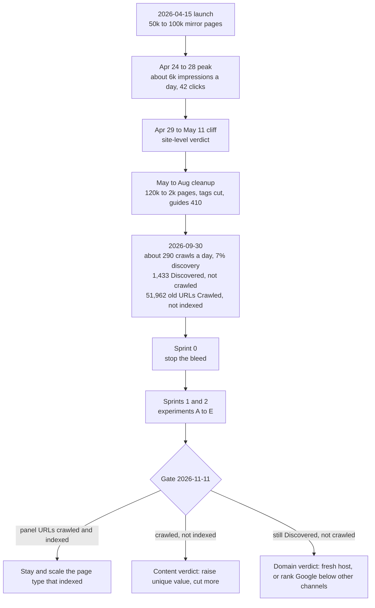

# SEO recovery

Status: open · 2026-10-03 · recovery implementation included in deployed `1ccf98ec`; gate 2026-11-11

**Next move:** Read the next Monday measurement after 09:00 Melbourne time. Check each Checkpoint date before comparison.

Done means: the gate table below has a decision for 2026-11-11, and every panel URL in [seo-recovery-panel.json](seo-recovery-panel.json) has a coverage state read on that date.

This brief supersedes the measurement plan in [EXECUTE-seo-keyword-rework.md](EXECUTE-seo-keyword-rework.md). It does not supersede that brief's surface list.

## Ledger

- [x] Sprint 0 implementation and the fixed panel included in deployed `1ccf98ec`
- [x] Verify Bing `sitemap_index.xml` and Google's exact retired child, `__sitemap__/retired-0.xml`, on 2026-10-08
- [x] Match all 41 panel URLs to Watched URLs on 2026-10-08
- [ ] Add a `b_linked` group of 10 Skill URLs to the panel before experiment B starts
- [ ] Add a NuxtSEO annotation on the day gscdump.com #557 goes live
- [ ] Weekly measurements 1 to 5 logged in the Log below, from 2026-10-12 to 2026-11-09
- [ ] Experiment A read
- [ ] Experiment B read
- [ ] Experiment D read
- [ ] Experiment E read
- [ ] Experiment F read, including coverage and relevant query impressions for the writing comparison
- [ ] Gate decision recorded on 2026-11-11
- [ ] Move this brief to `shipped/` once the gate decision is recorded

## Log

- 2026-10-21 Prepared ten Experiment B candidates in the [dated manifest](seo-link-experiment-candidates.json).
  All ten canonical destinations returned 200, allowed indexing, and appeared in the Skills sitemap.
  Each checked README contained no `skilld.dev` string; the manifest records its blob SHA.
  Both badge themes returned 200 SVG. Source resolution and current admission passed for each Skill.
  The retained Google checks span 20 August to 13 October; all ten reported unknown to Google.
  These are dated pre-recruitment observations, not current Google verdicts or link start dates.
  The [activation protocol](seo-link-experiment.md) starts each 14-day window only after a verified live link.
  The original 41 URLs and their groups retain their history. The 11 November gate stays fixed.

- 2026-10-21 Follow-up verified the deployed reference-file repair from #662.
  The huggingface `references/adapting-to-the-lora.md` link returned 200 HTML with its file title and noindex directive.
  Deployment [39320257178](https://github.com/skilld-dev/skilld.dev/actions/runs/39320257178) succeeded for `c1e3ad7a`, which contains #661 and #662.
  All 41 original panel URLs were checked. The 34 active URLs comprised 33 direct 200 responses and one canonical redirect.
  The `taste-skill/taste-skill` URL redirected to `/gh/leonxlnx/taste-skill`, which returned 200 and allowed indexing.
  Every active URL or its redirect target appeared in the current Sitemap. The Skills sitemap listed 127 URLs.
  Preserve the original panel URL and its observations; the redirect does not transfer its history to the target.
  All 41 watches retained the same latest Checkpoints as the 20 October read, spanning 14 to 18 October UTC.
  The active set still reported 33 unknown and one crawled, not indexed. These are retained verdicts, not new inspections.
  Search Console's available 11 to 17 October window reported zero clicks and 31 impressions; the previous window reported zero and 34.
  The site assessment was provisional: its data quality was `degraded`, with two unavailable proofs.
  Its ranked unknown-URL action remained count-only; its source snapshot was collected on 25 August.
  The crawled, not indexed action listed five of 5,414 reported URLs from an October 1 sample, including retired URLs.
  Neither action identifies a new sitewide repair cause. Keep intentional exclusions and the 11 November gate.
  Live Markdown twins for an excluded Skill and a multi-Skill Repository hub returned an index header.
  Their HTML pages returned noindex. The repair applies the existing Skill admission rule to direct Markdown sources.
  HTML conversion now carries the rendered robots directive into the Markdown response.

- 2026-10-20 NuxtSEO access succeeded after renewed browser pairing. CLI 0.5.10 read all 41 panel watches.
  Every watch had a Checkpoint. Latest Checkpoints span `2026-10-14T21:09:21Z` to `2026-10-18T08:46:05Z`.
  All predate Monday 19 October in Melbourne. This read cannot complete that Monday's comparison.
  The 34 active URLs reported 33 `unknown_to_google` and one `crawled_not_indexed`.
  The latter was `https://skilld.dev/gh/avdlee/swift-concurrency-agent-skill`, checked on 18 October.
  Its last reported Google crawl was `2026-08-30T03:04:29Z`, so the Checkpoint proves no new crawl.
  Active groups: `trending_sample` 19 unknown; `d_probe` two unknown; `demand` three unknown; `f_comparison` one unknown.
  The nine active `admitted_other` URLs reported eight unknown and one crawled, not indexed.
  Report the quality exclusion and dated Repository hub exclusion separately; each reported unknown.
  The five retired URLs reported three crawled, not indexed, and two excluded by noindex.
  Search Console's available seven days, 10 to 16 October, reported zero clicks and 34 impressions.
  The previous period reported zero clicks and 30 impressions. These totals do not establish traffic recovery.
  Google's exact retired-Sitemap read at `2026-10-19T14:51:22Z` reported 9,988 URLs, zero errors, and one warning.
  Its last download was `2026-10-18T03:20:05Z`; `isPending` was false.
  The Bing provider read returned `reauthorization-required`, so it supplied no current listing verdict.
  Cloudflare's Analytics API refused the weekly Googlebot query because the credential lacked Zone Analytics Read.
  Crawl-purpose share, a current Pages report, and a clean referring-domain count remain unavailable for this read.
  Current content from 30 public README search results yielded 36 distinct Skill destinations.
  This sample does not establish experiment B's ten eligible destinations or their link start dates.
  Both experiment D probes retain outside-link evidence; neither supplies an unlinked control.
  Live follow-up found valid reference-file URLs returning 404 despite successful asset API responses.
  Nuxt's Markdown negotiation claimed those file URLs before their guard ran. The repair moves that guard to Nitro's request hook.
  All five supplied avatar-image examples returned 200. The partial image action supplied five of eight reported URLs.
  Keep the existing freeze and 11 November gate. These observations do not justify broader indexing changes.

- 2026-10-20 HTTP checks covered all 41 panel URLs at `2026-10-19T14:07:51Z`.
  The 34 active, non-retired URLs returned 200, allowed indexing, and had self-canonical URLs and Sitemap entries.
  The five retired URLs returned 301. The existing quality exclusion returned `noindex,follow` and stayed outside the Skills sitemap.
  The `admitted_other` URL `https://skilld.dev/gh/axtonliu/axton-obsidian-visual-skills` rendered a multi-Skill Repository hub with `noindex,follow`.
  Production D1 held three resolved Skills: `excalidraw-diagram`, `mermaid-visualizer`, and `obsidian-canvas-creator`.
  Each Skill had `seo_indexable=1`. The hub had a self-canonical URL and no Skills sitemap entry.
  The October 1 entity policy deliberately excludes these hubs. Record this URL in its group's `excluded_urls`.
  Keep all 41 original URLs, their groups, and their history. The `admitted_other` group has nine active URLs for this read.
  These reads do not establish when the hub became noindex, or what Google indexed.
  The initial NuxtSEO CLI 0.5.10 attempt returned `state_error`: its saved keychain credential was unavailable.
  This HTTP and D1 read cannot complete the weekly Search Console measurement or decide experiment outcomes.

- 2026-10-13 Cloudflare's GraphQL Analytics API (`httpRequestsAdaptiveGroups`, zone `skilld.dev`) counted 2,219 verified Googlebot requests from 2026-10-06 to 2026-10-12 UTC, about 317 a day.
  By status: 200: 1,918. 403: 172. 301: 60. 404: 51. 204: 15. 524: 2. 410: 1. Unverified "Googlebot" user agents made 92 requests.
  All 172 verified 403 responses were OG image URLs under `/_og/d/…png`, refused by nuxt-og-image's signature check in the Worker.
  127 had no signature, and 45 had a signature that no longer verifies. The og:image URLs of the home page and 2 Skill pages returned 200.
  This read does not split discovery from refresh. The query and its baseline table are in Weekly measurement step 2.
  gscdump.com `docs/work/EXECUTE-bing-search-data-expansion.md` dates the Bing fix: a fixed-IP relay, [#628](https://github.com/harlan-zw/gscdump.com/pull/628), shipped on 2026-10-01 at 17:35 UTC.
  Its 2026-10-10 audit recorded seven completed skilld.dev search-data jobs on 4 to 10 October, with every dataset `ready`. Pages and Keywords held zero rows.

- 2026-10-11 readiness read with NuxtSEO CLI 0.5.8 matched all 41 watches, with no missing or empty Checkpoint lists.
  No Checkpoint changed from the earlier 10 October read. Latest Checkpoints span 4 to 8 October UTC.
  This is readiness evidence, not the first weekly measurement.
  Google's live retired-Sitemap read at `2026-10-10T12:59:13.326Z` reported 9,894 URLs, zero errors, and one warning.
  Bing's stored capture at `2026-10-10T08:32:44Z` listed the Sitemap with status `Failed` and zero URLs.
  A live request using Bingbot's User-Agent returned 200 for `robots.txt` and `sitemap_index.xml`. The failure cause remains unavailable.
  GitHub code search returned 24 README files. Their current content named 20 distinct `/gh/*` destinations.
  Live checks found 18 noindex destinations and two indexable destinations, both already in `d_probe`.
  This search does not establish experiment B's ten-page group or cover every outside link.
  The link evidence below removes experiment D's unlinked comparison assumption.

- 2026-10-08 NuxtSEO CLI 0.5.8 read all 41 panel watches, including the writing comparison's first Checkpoint.
  Its Checkpoint at `2026-10-08T08:34:39Z` reported `unknown_to_google`; its next due time was `2026-10-15T08:34:39Z`.
  The other 40 watches were due on 12 October between 08:09:39 and 08:10:41 Melbourne time.
  Those due times describe scheduling, not completed inspections.
  Google's live exact-Sitemap read at `2026-10-08T12:45:57.177Z` listed `https://skilld.dev/__sitemap__/retired-0.xml`.
  Google reported submission at `2026-09-30T16:21:54.774Z` and download at `2026-10-06T18:23:45.479Z`.
  It reported 9,846 URLs, zero errors, one warning, and `isPending: false`.
  Bing's stored capture at `2026-10-08T08:32:22Z` listed `https://skilld.dev/sitemap_index.xml` with status `Success`.
  Bing reported submission at `2026-10-02T08:30:31.349Z` and crawling at `2026-10-06T17:32:56Z`, covering 9,853 URLs.
  These provider records prove dated listing, not Page indexing. No Sitemap submission ran during these reads.
  Reproduce with the read-only commands in Weekly measurement below.

- 2026-10-08 The quality gate excludes `browser-use/plugins/browser-use` from the active recovery baseline.
  Production D1 retained its month-board admission from 2026-09-30, but recorded `seo_indexable=0` and `no_primary_trust_signal`.
  Its score record was 4, dated 2026-10-06 03:00:35 UTC. The source resolved and the Repository was healthy.
  Curator reasons, approved social posts, owner verification, and trust overrides were absent.
  The official Repository list names `browser-use/browser-use`, not `browser-use/plugins`.
  GitHub returned [the source](https://github.com/browser-use/plugins/blob/main/grok/skills/browser-use/SKILL.md) at D1's blob SHA, `0acbe30cb641795319aab5b3885dc0415266b375`.
  HTML returned noindex with a self-canonical URL. The Skills sitemap omitted it.
  [The quality rule](../../layers/registry/server/utils/skill-indexability.ts) requires a primary trust signal.
  [Trending admission](../../layers/registry/server/utils/trending-admission.ts) preserves admission, but does not waive that rule.
  Move the URL to `quality_excluded`; keep all 41 original URLs and the dated baseline evidence.
  The active trending sample has 19 URLs. No replacement receives the excluded URL's history.
  These reads do not establish when the URL first became noindex.

- 2026-10-05 Harlan approved experiment F for `/compare/humanize-writing-skills` at the existing 11 November gate.
  One comparison joins the panel, taking it from 40 to 41 URLs. Existing groups remain unchanged.
  The target query estimate is 30 US searches per month. This is a named experiment exception to the volume bar.
  Harlan also requested author credit. The article retains its agent research and drafting disclosure.

- 2026-10-03 Deployment [37038090688](https://github.com/skilld-dev/skilld.dev/actions/runs/37038090688) passed on `1ccf98ec`.
  Its history includes Sprint 0, #325, #332, #333, and #334. No fresh crawl or indexing results were read.
  Panel loading, sitemap submissions, and the cross-repository gscdump release sequence need separate evidence.
  Drafts #318, #320, and #321 remain deferred under the October 1 decisions.

- 2026-09-30 Brief written from the 2026-09-30 NuxtSEO and Search Console reads. Panel of 40 URLs fixed.
- 2026-10-01 Owner deferred experiment C. Template changes wait. #318 stays in draft. The panel keeps 40 URLs; the C groups became one `trending_sample` of 20.
- 2026-09-30 Two panel Skills left the index after #322 admitted only trending Skills: `onmax/nuxt-skills/arkenv` and `pbakaus/agent-reviews/resolve-agent-reviews` were on no board. `ferdinandobons/startup-skill/startup-pitch` and `browser-use/plugins/browser-use` replace them in the trending sample. `dpearson2699/swift-ios-skills/swift-concurrency` takes the place of the second one in `admitted_other`.

## Diagnosis

Google gave the site a sitewide quality verdict. The site has no trust signals to recover with.

- The pattern is a honeymoon, then a site-level demotion. This is not classic "new site jail". A jailed site never gets past the homepage.
- skilld was indexed and ranking within 10 days of the 2026-04-15 launch. It reached about 6k impressions a day, position about 8, and 42 clicks on 2026-04-28.
- The cliff started on 2026-04-29. The March core update ended on 2026-04-08. The May core update started on 2026-05-21. So a continuously running system caused it, not a named update.
- The cliff came before skilld's own cuts on 2026-05-04 and 2026-05-08. Google moved first.
- Search Console over-counted impressions until 2026-04-27, so the peak may be inflated. Clicks fell from 42 to about 1 at the same time. The drop is real.
- About 50k pages copied from GitHub went live in April. 72% of the main text on a Skill page is the GitHub SKILL.md, word for word (sample: `anthropics/skills/frontend-design`).
- The site has almost no links, no brand searches, and no referral traffic. Nothing prompts Google to look again.
- The current curated set is "Discovered, currently not indexed". Google queued it but never crawled it. So the limit is demand, not content.
- The 51,962 old April URLs are "Crawled, currently not indexed". Google read them, rejected them, and still holds them.
- Cleanup alone fixes the first cause at best. No case in the outside research recovered from cleanup alone within 6 months on the same domain.
- Moving the same content to a fresh host would likely carry the verdict with it. A new host helps only with pages that are different and better.



## Evidence

All values are dated 2026-09-30 unless stated. Sources: NuxtSEO CLI, the Search Console UI, and the site's own checks.

| Signal | Value | Source |
| --- | --- | --- |
| Clicks, 6 months | 178. The last click was 2026-07-26 | NuxtSEO search analytics |
| Impressions, late September | 0 to 5 per day | NuxtSEO search analytics |
| Retained URL Inspection | 1 indexed (the homepage) of 1,487. 1,484 read "URL is unknown to Google". The capture time is null | NuxtSEO indexing summary |
| Homepage last crawl | 2026-08-30 | NuxtSEO indexing urls |
| Sitemap | `skills-0.xml` submitted 2026-08-22, last read 2026-09-22, 1,389 URLs discovered | Search Console sitemaps |
| Brand query `skilld` | 44 impressions in 6 months, average position 20.6 | NuxtSEO keywords |
| Backlinks | 36 referring domains. 20 come from 2 spam networks. 16 are clean | NuxtSEO backlinks summary |
| Referral sessions, 28 days | GitHub 10, Bing 20 | NuxtSEO source and medium |

The retained URL Inspection is stale. 1,231 of its verdicts date from 2026-08-20 to 2026-08-22. "Unknown" URLs back off from 7 to 120 days between re-checks. Trust the Pages report below instead.

### Pages report, "Why pages aren't indexed"

| Reason | Pages | Validation | Read |
| --- | ---: | --- | --- |
| Crawled, currently not indexed | 51,962 | Failed | The old April URLs. Google holds them |
| Excluded by noindex | 16,639 | Failed | Retired or non-curated pages. Works as intended |
| Soft 404 | 2,621 | Started | Made-up `/gh/...` URLs returned HTTP 200 with a thin noindex page. #317 fixes the cause |
| **Discovered, currently not indexed** | **1,433** | Not started | **The current curated set** |
| Not found (404) | 398 | Not started | Fine |
| Alternate page with proper canonical | 5 | Failed | Fine |
| Duplicate, Google chose a different canonical | 2 | Started | Fine |

- Do not click "Validate fix" on "Crawled, currently not indexed". It already failed and proves nothing.
- Google's view is about 52k rejected URLs against 1.4k current ones. At about 29 HTML crawls a day, clearing that history takes a long time. Experiment E targets it.

### Crawl stats, 90 days to about 2026-09-28

| Signal | Value | Read |
| --- | --- | --- |
| Total requests | 26.3k, about 290 per day | Google still visits |
| By file type | JavaScript 58%, other 16%, HTML 10%, CSS 2%, image 2% | About 29 HTML pages per day |
| By Googlebot type | Page resource load 73%, smartphone 19%, image 8% | Most of the crawl renders |
| By purpose | Refresh 93%, discovery 7% | Google barely explores |
| By response | 200: 78%. 301: 9%. 404: 7%. Other 4xx (410): 5%. DNS error: under 1% | 21% goes to dead or moved URLs |
| Average response time | 392 ms | HTML alone is slower |
| Hosts | `skilld.dev` 26,189 requests, `www.skilld.dev` 68 | `www` has no DNS record |

Site checks on 2026-09-30:

- A Skill page references 82 JS files. 64 of them are modulepreload.
- The site had about 17 or more successful deploys in 30 days. Each deploy changes chunk hashes, so Google fetches the JS again. That explains the 58% JS share.
- Skill page HTML has `cache-control: private, no-store` and `cf-cache-status: BYPASS`. Time to first byte is 0.2 s to 0.4 s warm and 1 s to 2.7 s cold.

What this means:

- Crawl demand limits the site, not crawl capacity. Google says crawl budget rarely matters under 10k URLs.
- Crawl waste is still cheap to cut: dead URLs (21%), JS churn, and the `www` DNS errors.
- Discovery share is the fastest feedback signal. It moves before indexing does.

### Outside evidence

Google statements:

- Mueller and Splitt, 2026-07-16: with strong quality doubts, Google crawls and indexes less. That matches the 1,433 Discovered URLs.
- Mueller, 2026-09-07: Google "possibly lost faith" in a site because of its old pages. Deleting them is "a starting point". Filler added to generated pages does not help.
- Recovery takes "several months", with no maximum. After a few quiet months, the wait often ends at a core update.
- 404, 410 and noindex count the same.
- Mueller, 2025-11-28: a new domain can be faster than repairing a bad one. Moving the same content to it tends to carry the problem across.
- AI Overviews and AI Mode cite only pages in Google's index. They give no way around the verdict.

Updates: the September 2026 spam update started rolling out on 2026-09-24. It may run until about 2026-10-08. Read no results until it ends. No core update has been announced since 2026-06-02.

Observed cases:

- Spam-style recovery: 5 months at the fast end.
- Helpful-content-style suppression: 12 to 24 months. After 11 months, only 22% of sites had partly recovered (Glenn Gabe).
- Aggregators lost ground in the 2026 core updates. First-party sources gained.
- Request indexing and the Indexing API were tried 6 times in 43 reports. Neither worked alone.
- GetInvoice cut 22k AI pages. After 6 months with no recovery, it restarted on a new domain. That worked.
- Weird Gloop found about 90% of new-domain wikis stuck with only the homepage indexed. That is the same shape as skilld. A subdomain of an established host indexed within about 1 week. Escapes followed demand spikes and steady links from Steam news posts.

### Drift since the cleanup

- The skills table grew from about 2.1k to 14.8k rows.
- An estimated 3k to 5k Skill pages are `index,follow` but missing from the sitemap.
- About 15 new indexable marketing pages went live on 2026-09-04 (`/agents/*`, `/vs/*`).
- Eight tag pages and five retired collections stayed indexable.
- IndexNow was off from 2026-07-26 after 8 days of HTTP 429 errors.
- The 2026-09-10 measurement in [EXECUTE-seo-keyword-rework.md](EXECUTE-seo-keyword-rework.md) never ran.

Competitors rank for our queries: skills.sh, skillsdirectory.com, agenticskills.io, and openagentskill.com. The niche is open. Every Skill-specific competitor gets 5.2k organic visits a month or less. The three trends measured fell 22% to 29%.

## Sprint 0, 2026-10-01 to 2026-10-07: stop the bleed

Check each PR with `gh pr view <n> --repo skilld-dev/skilld.dev`.

| # | Item | PR |
| --- | --- | --- |
| 1 | The sitemap equals the indexable set: trending boards (week, month, all) plus 2 probe pages. 65 Skills at the start. The set only grows after the gate. humanizer, taste-skill and visual-explainer are in. ui-ux-pro-max, caveman, ponytail and stop-slop are out | [#322](https://github.com/skilld-dev/skilld.dev/pull/322) |
| 2 | Freeze and marketing page audit. Bar: 100 searches a month. `/agents/codex`, `/agents/cursor`, `/agents/claude-code` and `/vs/context7` stay indexable. The rest are noindex | [#322](https://github.com/skilld-dev/skilld.dev/pull/322) |
| 3 | Hygiene: tag chip links, noindex URLs out of sitemaps, related lists skip gone Skills, 8 tag pages noindex; 5 stale collections retired | [#322](https://github.com/skilld-dev/skilld.dev/pull/322), [#326](https://github.com/skilld-dev/skilld.dev/pull/326) |
| 4 | No zone rate limit on `/gh/*` exists, so nothing to exempt. 60 parallel requests to one `/gh/` page all returned 200 on 2026-09-30 | [#324](https://github.com/skilld-dev/skilld.dev/pull/324) |
| 5 | Crawl waste: `www` 301; 75 to 19 JS preloads; HTML edge cache | [#316](https://github.com/skilld-dev/skilld.dev/pull/316), [#323](https://github.com/skilld-dev/skilld.dev/pull/323), [#328](https://github.com/skilld-dev/skilld.dev/pull/328), [#329](https://github.com/skilld-dev/skilld.dev/pull/329) |
| 6 | Real 404 and 410 for missing Skills; 503 with `Retry-After` when the lookup fails | [#317](https://github.com/skilld-dev/skilld.dev/pull/317) |
| 7 | Recovery URL panel | [seo-recovery-panel.json](seo-recovery-panel.json) |
| 8 | Author profiles, collections, owner hubs and multi-Skill repository hubs render `noindex,follow`. The `authors` and `sources` sitemaps are gone (owner decision, 2026-10-01). A single-Skill repository hub is the Skill's page and stays in the skills sitemap when the trending admission rule admits it | this change |

Checks:

- `curl -sI https://www.skilld.dev/` shows the `www` redirect.
- `curl -sI https://skilld.dev/gh/harlan-zw/gscdump | rg -i 'cache-control|cf-cache-status'` shows the HTML cache headers.
- `curl -s -o /dev/null -w '%{http_code}\n' https://skilld.dev/gh/nobody/nothing/nothing` shows the missing Skill status.

Historical merge order, recorded before the October 3 check-in:

Check a PR with `gh pr view <n> --repo skilld-dev/skilld.dev`.

1. [#332](https://github.com/skilld-dev/skilld.dev/pull/332), the `return_to` fix, merged before deployed `1ccf98ec`.
2. [#334](https://github.com/skilld-dev/skilld.dev/pull/334), the edge cache check, merged before deployed `1ccf98ec`.
3. [#331](https://github.com/skilld-dev/skilld.dev/pull/331), this brief, and [#333](https://github.com/skilld-dev/skilld.dev/pull/333), the Monday check-in, merged before deployed `1ccf98ec`.
4. Keep in draft, do not merge:
   - [#318](https://github.com/skilld-dev/skilld.dev/pull/318), experiment C, deferred on 2026-10-01.
   - [#320](https://github.com/skilld-dev/skilld.dev/pull/320), IndexNow. On 2026-10-01 the owner moved IndexNow submission to another service.
   - [#321](https://github.com/skilld-dev/skilld.dev/pull/321), which shows the badge block only on indexable hubs. A badge on a noindex page still brings people to the site, so the gate is not needed (owner, 2026-10-01).

gscdump family:

1. [gscdump #147](https://github.com/harlan-zw/gscdump/pull/147) (trend analyzer), then [gscdump #148](https://github.com/harlan-zw/gscdump/pull/148) (coverage states, capture, Watched URLs).
2. Release `@gscdump/*` 4.6.0. Version 4.5.0 did not include #147 and #148.
3. Refresh the gscdump.com lockfile to 4.6.0. Run fleet migrations 0013 and 0014 as the gscdump.com runbook says.
4. [gscdump.com #557](https://github.com/harlan-zw/gscdump.com/pull/557), then [#556](https://github.com/harlan-zw/gscdump.com/pull/556).
5. [nuxtseo.com #1312](https://github.com/harlan-zw/nuxtseo.com/pull/1312) dates the indexing summary from the gscdump capture time. When nuxtseo moves off gscdump 3.8.0, add `not_indexed` to every exhaustive `HealthStage` map.

After #557 is live, the counts behind each coverage bucket change meaning. Triage gains a `not_indexed` stage. Trend charts show a step on that day. Add a NuxtSEO annotation.

## The panel

[seo-recovery-panel.json](seo-recovery-panel.json) defines the measurement groups and their URLs.

| Group | URLs | Treatment | Expect |
| --- | ---: | --- | --- |
| `trending_sample` | 19 | None. No template change | Baseline for admitted trending pages |
| `quality_excluded` | 1 | Quality gate excludes the page | Observe coverage separately; omit from active recovery decisions |
| `d_probe` | 2 | Two linked pages (experiment D) | Record coverage for both; this pair cannot isolate a link effect |
| `demand` | 3 | High search demand, in the trending set | First to earn impressions if indexed |
| `admitted_other` | 10 retained, 9 active on 2026-10-20 | Trending set only; one intentional hub exclusion | Trending-only baseline |
| `retired` | 5 | Retired URLs in the retired sitemap (experiment E) | Move out of "Crawled, currently not indexed" |
| `f_comparison` | 1 | Original source comparison with contextual internal links | Indexed with impressions for relevant prose editing or comparison queries |
| `b_linked` | 10, to fill | Outside links from README badges (experiment B) | Crawled or indexed within 14 days of the link |

The `b_linked` group records Skill destinations with verified outside links, up to ten URLs.
The [candidate manifest](seo-link-experiment-candidates.json) records preparation separately.
As links land, follow the [activation protocol](seo-link-experiment.md) and add their destinations to the group.
Preserve each URL's first live observation and the original panel history.

Baseline: the Pages report of 2026-09-30. The curated URLs sit in "Discovered, currently not indexed". The retired URLs sit in "Crawled, currently not indexed". The first per-URL reading comes from gscdump Watched URLs, after gscdump 4.6.0 and gscdump.com #557 are live. Load the panel with `gscdump indexing watch add`. Add at most 50 URLs per call.

## Weekly measurement

Every Monday from 2026-10-12, read after 09:00 Melbourne time, allowing about 10 minutes.
The 07:40 daily check-in precedes the expected inspections; its SEO section is provisional.
Follow the [check-in runbook](../runbooks/checkin.md#seo-recovery-measurement) for the later read. It is not separately scheduled.
The first read waits for the spam update to end. Log one line per week in the Log above.

Use NuxtSEO CLI 0.5.8 or newer with its matching Skill. Pass `--site s_08aae654 --json` on each command:

```sh
nuxtseo search watches --site s_08aae654 --json
nuxtseo sitemaps submission --site s_08aae654 --json
nuxtseo sitemaps inspect https://skilld.dev/__sitemap__/retired-0.xml --engine google --site s_08aae654 --json
nuxtseo sitemaps inspect https://skilld.dev/sitemap_index.xml --engine bing --site s_08aae654 --json
```

CLI 0.5.8 `pull` omits these reads. Google reads live; Bing returns a dated stored capture.
Record exact listing separately from Site-level submission state. Neither proves Page indexing.
Report unavailable evidence separately from a missing Sitemap. Do not submit or delete Sitemaps during measurement.

1. Match exact panel URLs to `search watches`. Report missing watches, extra watches, and empty Checkpoint lists separately.
   Select each URL's latest Checkpoint by `checkedAt`. Retain its provider state, last crawl time, and `dueAt`.
   Separate Monday Checkpoints from older verdicts, even after 09:00. Report older verdicts as last known, with dates.
   A missing or older Checkpoint leaves that URL's weekly measurement incomplete. Never infer completion from `dueAt`.
   Keep the comparison's Thursday cadence. Never request fresh inspections to align the panel.
   Record the rung: unknown, discovered, crawled, indexed. Preserve noindex and other exclusion states separately.
   Missing evidence is unavailable, not unknown to Google. Keep retained summary totals separate from panel counts.
   Report `quality_excluded` separately. Exclude it from active recovery totals and experiment scale or kill decisions.
   Recheck its quality eligibility each week. If eligibility changes, record the date before changing its group.
   Keep its earlier observations in their original group. Never treat an intentional noindex as failed recovery.
   Read each group's optional `excluded_urls`. Keep these URLs in their original group and preserve their historical observations.
   From each entry's `observed_at`, report its URL and reason separately from active recovery totals and experiment decisions.
   Recheck eligibility on each read. A noindex Repository hub does not establish a content or domain verdict.
   Do not substitute a child Skill URL or backdate an exclusion without evidence.
2. Read Search Console crawl stats in the UI. This is the leading signal.

   | Signal | Baseline |
   | --- | --- |
   | Discovery share | 7% |
   | HTML share | 10% |
   | Share of 404, 410 and 301 responses | 21% |

   Then read Googlebot requests by status from Cloudflare's GraphQL Analytics API, zone `skilld.dev`.
   The query reads `httpRequestsAdaptiveGroups` with `userAgent_like: "%Googlebot%"` and groups by `edgeResponseStatus`.
   A row with `verifiedBotCategory: "Search Engine Crawler"` is verified Googlebot. Any other row is an unverified user agent that names Googlebot.
   The Free plan keeps 31 days of these rows, so read every week. Move both date filters forward 7 days for each reading.
   Send it to `https://api.cloudflare.com/client/v4/graphql` with a Zone Analytics Read token from the environment. Never write the token here.
   This read does not split discovery from refresh. The Search Console UI stays the source for discovery share.

   ```graphql
   query GooglebotVerified($zoneTag: string!) {
     viewer {
       zones(filter: { zoneTag: $zoneTag }) {
         byStatus: httpRequestsAdaptiveGroups(limit: 200, orderBy: [count_DESC], filter: { datetime_geq: "2026-10-06T00:00:00Z", datetime_lt: "2026-10-13T00:00:00Z", requestSource: "eyeball", userAgent_like: "%Googlebot%" }) { count dimensions { edgeResponseStatus verifiedBotCategory } }
         blocked: httpRequestsAdaptiveGroups(limit: 500, orderBy: [count_DESC], filter: { datetime_geq: "2026-10-06T00:00:00Z", datetime_lt: "2026-10-13T00:00:00Z", requestSource: "eyeball", userAgent_like: "%Googlebot%", edgeResponseStatus_in: [403, 429] }) { count dimensions { edgeResponseStatus verifiedBotCategory clientRequestPath edgeResponseContentTypeName securityAction securitySource originResponseStatus } }
       }
     }
   }
   ```

   Pass `{ "zoneTag": "632f05c809f879ddb0cd77e845e515f5" }`, the zone ID of `skilld.dev`, as the variables.

   | Signal, 2026-10-06 to 2026-10-12 UTC | Baseline |
   | --- | --- |
   | Verified Googlebot requests | 2,219, about 317 a day |
   | Verified, by status | 200: 1,918. 403: 172. 301: 60. 404: 51. 204: 15. 524: 2. 410: 1 |
   | Unverified "Googlebot" user agents | 92 requests |

   All 172 verified 403 responses in that window were OG image URLs under `/_og/d/…png`.
   The Worker answered them through nuxt-og-image's signature check: 127 URLs had no signature, and 45 had a signature that no longer verifies.
   On 2026-10-13, the og:image URLs of the home page and 2 Skill pages returned 200.

3. Read impressions and clicks over 7 days, and impressions for the brand query `skilld`.
4. Read clean referring domains from separately dated retained evidence, and GitHub and Bing referral sessions.
   If backlink evidence is unavailable, say so. Do not start paid research to discover whether a result is cached.
5. Read the Pages report totals: "Crawled, currently not indexed" (baseline 51,962) and "Discovered, currently not indexed" (baseline 1,433).

Read no result before the September 2026 spam update ends, about 2026-10-08. The first read is 2026-10-12.

## Experiments, 2026-10-08 to 2026-11-04

Each experiment makes one demand signal. Each has a scale rule. If the scale rule fails by its read date, stop the experiment and log the result. Keep its surface only if it serves Loop 1.

### Trending-only indexable set

Sprint 0 item 1 is the base for every experiment. Only Skills admitted from the trending boards, and the named exceptions, are indexable. Stop adding pages until the gate. This limits the site to one clear claim: these are the Skills people talk about.

### A. Bing as a control

- Measures: Bing's per-URL index status for the panel. The original 40-URL baseline is 2026-09-30.
- Setup: skilld.dev was connected to Bing in gscdump on 2026-09-30 and held no data. Harlan submits `https://skilld.dev/sitemap_index.xml` in Bing Webmaster Tools. IndexNow submission moves to another service (owner decision, 2026-10-01). [#320](https://github.com/skilld-dev/skilld.dev/pull/320) stays in draft.
- Bing data: from about 2026-09-08, Bing refused gscdump's calls from Cloudflare's shared egress IPs (`ThrottleIP`), so its traffic and crawl reads failed for every Site.
  gscdump.com [#628](https://github.com/harlan-zw/gscdump.com/pull/628) sends Bing Webmaster API calls through a fixed-IP relay. It shipped on 2026-10-01 at 17:35 UTC.
  gscdump's audit on 2026-10-10 recorded seven completed skilld.dev search-data jobs on 4 to 10 October, with every dataset `ready`. Pages and Keywords held zero rows.
  Source: gscdump.com `docs/work/EXECUTE-bing-search-data-expansion.md`, Log entries dated 2026-10-01 to 2026-10-10.
- Read on 2026-10-12, after the spam update ends.
- Scale rule: if Bing indexes the curated pages and Google does not, the content can be indexed. The problem is Google's verdict on the domain.
- Bonus: Bing feeds ChatGPT and Copilot answers.

### B. Demand and links

- Measures: the `b_linked` group. Add it to the panel first.
- Setup:
  - Use the [candidate manifest](seo-link-experiment-candidates.json) to prepare ten relevant README link requests.
    Its pool is the first 50 reviewed individual Skill Repositories on the Repository leaderboard, ordered by GitHub stars.
    The badge and embed snippet already exist at `/b/<owner>/<repo>` and `/brand-kit/github-badge`.
  - Make the skilld CLI print canonical Skill page URLs ([skilld #178](https://github.com/skilld-dev/skilld/pull/178), after [#327](https://github.com/skilld-dev/skilld.dev/pull/327)).
  - Publish one launch post on established hosts: harlanzw.com, X, HN, r/ClaudeAI. Use original data, for example "we ran the top 50 Skills across 4 Agents".
- Never buy links. Leave the 20 spam network domains alone. Disavow only if a manual action appears.
- Read at 14 days.
- Scale rule: if five of ten linked URLs move from unknown or discovered to crawled or indexed, investigate further.
  Each URL has 14 days from its own verified live link. Apply the [dated evidence rules](seo-link-experiment.md#measurement).
  This is an observational signal; it does not establish that links caused the change.

### C. Unique value template (deferred)

- Deferred by the owner on 2026-10-01. Template changes wait. [#318](https://github.com/skilld-dev/skilld.dev/pull/318) stays in draft.
- To revive: undraft #318, split `trending_sample` back into treatment and control groups, and add a scale rule.

### D. Trusted host link probe

- Measures: `d_probe`. Record coverage for the two linked pages. This pair cannot isolate a link effect.
- Setup: links beside install steps that already exist on Harlan's sites. No new posts.
  - `gh/harlan-zw/gscdump` is the linked page. gscdump.com/skill and the gscdump docs ([gscdump #149](https://github.com/harlan-zw/gscdump/pull/149)) link to it.
  - `gh/harlan-zw/nuxt-seo/nuxtjs-seo` also has a README link.
    [Nuxt SEO commit `f7aadee`](https://github.com/harlan-zw/nuxt-seo/commit/f7aadee2263236d8ee14ef76dcd4e1a980810cd7) added its canonical Skill link on 2026-09-29.
    The current root README retains that link, checked on 2026-10-11.
    Dropping the separate nuxtseo.com proposal ([#1314](https://github.com/harlan-zw/nuxtseo.com/pull/1314)) did not remove this existing README link.
- Both pages are named exceptions to the trending-only rule, so they are indexable. Approved 2026-09-30.
- The 14 day clock starts on 2026-09-30, when #322 went live. Both links to the gscdump page were live by then.
- Scale rule: withhold the linked-versus-unlinked conclusion for this pair. Both pages had README links before the clock started.
  Keep both URLs and their Checkpoint histories. A separate unlinked comparison needs an owner decision.
- Fallback if that read is unclear: publish 3 to 5 original write-ups on harlanzw.com that link to 2 or 3 panel URLs. This needs new posts, so it waits for content work.
  Record any later crawl results without claiming that this pair proves a link effect.

### E. Retired sitemap

- Measures: the `retired` group and the Pages report totals.
- Setup ([#325](https://github.com/skilld-dev/skilld.dev/pull/325)): publish a temporary `retired.xml` sitemap. It lists retired URLs that now return 410, 404 or 301, each with a fresh `lastmod`. Harlan submits it in Search Console. Remove it after 4 to 6 weeks.
- Confidence: medium. Mueller has said a temporary sitemap with changed URLs and fresh `lastmod` can speed up recrawling. This is practitioner advice, not documented policy.
- Read at 4 weeks.
- Scale rule: "Crawled, currently not indexed" falls by 10k or more in 4 weeks. The Soft 404 and 404 counts rise, then clear.

### F. Editorial comparison and internal links

- Measures: `f_comparison`, the single writing comparison approved by Harlan on 5 October 2026.
- Setup: admit the comparison; link from the homepage work section, canonical anti-slop track, and three featured Skills.
- The comparison links back to those Skill pages and the track. Supporting source links remain pinned to reviewed commits.
- This combines editorial content and links. It cannot isolate either effect or prove an improvement in rankings.
- Read coverage, relevant query impressions, clicks, and crawl dates during weekly measurements and at the gate.
- Retain the admission if the page is indexed and receives relevant prose editing or comparison query impressions.
- Otherwise remove its `PAGE_ADMISSIONS` entry, returning the page to noindex and excluding it from the sitemap.
- New comparison pages remain gated. Any expansion needs a separate admission decision.

## Gate table, 2026-11-11

The gate falls about 3 months after the last large removal.

Apply this table to active experiment URLs. The `quality_excluded` group cannot establish a content or domain verdict.

| Panel result | Read | Decision |
| --- | --- | --- |
| Experiment URLs indexed | The recovery path is open | Stay. Scale the page type that indexed. Lift the freeze step by step |
| Crawled, not indexed | Content verdict | Cut harder. Keep only pages with unique data. Raise the unique-value bar |
| Still "Discovered, currently not indexed" after 10 or more new clean referring domains and trusted host links | The domain verdict sticks | Choose: a fresh host for the curated set with no 301 at first (the GetInvoice and Weird Gloop pattern), or rank Google below GitHub, the CLI and social for Loop 1 |

Loop 1 does not depend on Google. The CLI, GitHub badges and social posts drive discovery directly. The actions that feed Google (links, brand demand) also grow Loop 1. So the plan pays off if Google never recovers.

## Gaps against competitors

12 competitor domains checked with 29 research calls. The gap is ranking, not coverage. skilld has a page for most of the demand. Those pages do not rank because of the domain verdict.

Legend: "b" means skilld has the Skill, but the page is not indexable or not in the sitemap on 2026-09-30.

| Query | Searches a month | KD | skilld state |
| --- | ---: | ---: | --- |
| ui ux pro max skill | 5,400 | 7 | b, noindex |
| blader/humanizer | 1,900 | 0 | b, not in sitemap |
| caveman skill | 1,600 | 7 | b, noindex |
| ponytail skill | 880 | 9 | b, not in sitemap |
| mcp vs skills | 720 | 5 | new concept page |
| marketing skills claude | 720 | n/a | b, Repository page noindex |
| stop slop skill | 590 | 0 | b, not in sitemap |
| taste skill claude | 590 | 4 | b, not in sitemap |
| claude skill vs agent | 480 | 8 | new concept page |
| visual explainer | 320 | n/a | b, not in sitemap |
| claude skill vs command | 170 | 14 | new concept page |
| cursor rules vs skills | 110 | 3 | new concept page |

Three page types capture the gap without mass generated pages:

1. Curated Skill and Repository pages for named Skills: about 12.9k searches a month. Give each a curator reason, allowlist its Repository in `supported_repos`, and put "Claude Code skill" in the title.
2. Five human written concept pages: about 3.1k.
3. Track pages extended by curation: about 1.1k. Run these only as an experiment with a cull path. They fall outside VISION's core user.

Out of scope: bare project names (36.9k) and competitor brand queries (11.9k). They are navigational. A registry cannot win them.

## Open questions

- Which indexed count is true? Screenshot the Search Console Pages report once and log the total each week.
- Did the 2026-05-08 change that stripped content from Skill pages deepen the drop?
